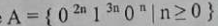
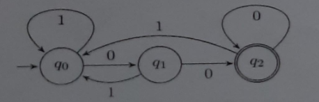

# University of Barishal
### Department of Computer Science and Engineering
**Final Exam | Semester: 6th**

- **Course:** Course Title: Theory of Computation (CSE-3203)
- **Session:** 16-17
- **Time:** 180 minutes | **Full Marks:** 60.00
- **Course Teacher:** 

---
> *Answer any Five (5) Questions from the followings.*

---

### 1. 

**a)** Analyze the terms: Theorems, Lemmas and Corollaries.

**b)** What is Automata Theory? Describe the applications of Finite Automata.

**c)** A containment hierarchy of classes of formal languages has been classified as The Chomsky Hierarchy. Describe with suitable figure(s).

---

---

### 2. 

**a)** Define push down automata with example.

**b)** Give pushdown automata that recognize the following languages: (a) A = { w ∈ {0, 1} * | w contains at least three 1s } (b) B = { w ∈ {0, 1} * | w = w^R and the length of w is odd }

**c)** Use the pumping lemma to prove that the language A is not context free.

---

---

### 3. 

**a)** What is Turing Machine? Give advantages of it.

**b)** Construct a Turing Machine that accepts the language of palindromes over {a,b}. Also specify the moves to trace the strings abaa, abba,aabaa.

**c)** What is meant by a halting problem in a Turing Machine? Explain with an example.

---

---

### 4. 

**a)** Let, Σ = {0, 1} Construct a DFA for the following language: L = {w | w is a binary string that has even number of 1s and even number of 0s}

**b)** Construct a NFA for the following: Strings where the first symbol is present somewhere later on at least once.

---

---

### 5. 

**a)** Build an NFA for the following language: L = { w | w ends in 01}

**b)** Describe the Advantages & Caveats for NFA.

**c)** Convert the NFA from Question 5(a), to DFA.

---

---

### 6. 

**a)** Why explicit ε-transitions in finite automata is important?

**b)** Build an ε-NFA for the following language: L = {w | w is empty, or if non-empty will end in 01}

**c)** Convert ε-NFA to DFA based on Question 6(b) Question - 6(b): Build an ε-NFA for the following language: L = {w | w is empty, or if non-empty will end in 01}

---

---

### 7. 

**a)** Describe the relation between Regular Expressions (RE) and Finite Automata. Show with figure that they are interchangeable.

**b)** Convert the following RE to ε-NFA: (0+1)*01(0+1)*

---

---

### 8. 

**a)** Construct a context-free grammar for the following DFA:

**b)** Show that the grammar ({S}, {a, b}, R, S) with rules R = S -> aS | aSbS | € is ambiguous.

**c)** Does a push down automata have memory? Justify.

---

---

---

---

- 

- 

---

---

---

---

