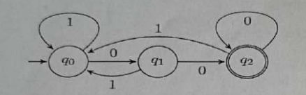
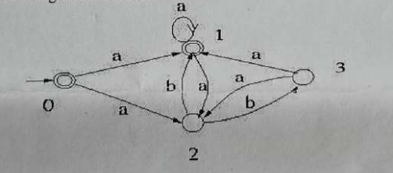
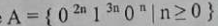

# University of Barishal
### Department of Computer Science and Engineering
**Final Exam | Semester: 6th**

- **Course:** Course Title: Theory of Computation (CSE-3203)
- **Session:** 17-18
- **Time:** 180 minutes | **Full Marks:** 60.00
- **Course Teacher:** 

---
> *Answer any five sets of questions from the followings.*

---

### 1. 

**a)** Construct a context-free grammar for the following DFA:

**b)** In compiler, ambiguous testing is a very important matter. Show that the grammar ({S}, {a, b}, R, S) with rules R = S -> aS | aSbS | € is ambiguous.

**c)** Does a push down automata have memory? Justify.

---

---

### 2. 

**a)** Why explicit ε-transitions in finite automata is important?

**b)** Build an ε-NFA for the following language: L= {w | w is empty, or if non-empty will end in 01}

**c)** Convert ε-NFA to DFA based on Question 2(b)

---

---

### 3. 

**a)** Differentiate between Finite State and Turing Machines.

**b)** Convert the following NFA to DFA.

**c)** How a DFA processes strings?

---

---

### 4. 

**a)** Define push down automata with example.

**b)** Give pushdown automata that recognize the following languages: (a) A = {w ∈ {0, 1} * | w contains at least three 1s } (b) B = {we {0, 1} * | w = w^R and the length of w is odd }

**c)** Use the pumping lemma to prove that the language is not context free.

---

---

### 5. 

**a)** Let, ∑ = {0, 1}. Construct a DFA for the following language: L = {w | w is a binary string that has even number of 1s and even number of 0s}

**b)** Construct a NFA for the following: Strings where the first symbol is present somewhere later on at least once.

---

---

### 6. 

**a)** Prove that the following language is either regular or not. A= { w w w | w ∈ {a, b} * }

**b)** Prove that if we add a finite set of strings to a regular language, the result is a regular language.

**c)** Write the closure properties of regular languages.

---

---

### 7. 

**a)** Describe the relation between Regular Expressions (RE) and Finite Automata. Show with figure that they are interchangeable.

**b)** Convert the following RE to ε-NFA: (0+1)*01(0+1)*

---

---

### 8. 

**a)** Find DFA's which accepts the following languages: (i) Strings over {a, b} ending in aa. (ii) String over {a, b} containing three consecutive a's (that is, contains the substring aaa) (iii) All strings over {a, b} where each string of length 5 contains at least two a's.

**b)** Consider the regular expression (a(cd)*b)*. (i) Find a string over {a, b, c, d}^4 which matches the expression. (ii) Find a string over {a, b, c, d}^4 which does not match the expression.

**c)** Does a push down automata have memory? Justify.

---

---

---

---

- 

- 

---

---

---

---

