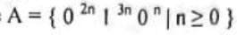
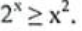
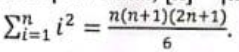
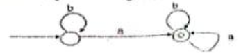

# University of Barishal
### Department of Computer Science and Engineering
**Final Exam | Semester: 6th**

- **Course:** Course Title: Theory of Computation (CSE-3203)
- **Session:** 18-19
- **Time:** 180 minutes | **Full Marks:** 60.00
- **Course Teacher:** 

---
> *Answer Any Five (5) Questions From The Following*

---

### 1. 

**a)** What is Automata Theory? Describe the applications of Finite Automata.

**b)** Explain the work of lexical analyzer with an on/off switch.

**c)** The Chomsky Hierarchy is a containment hierarchy of classes of formal languages. Describe with suitable figure(s).

**d)** Analyze the terms: Theorems, Lemmas and Corollaries.

---

---

### 2. 

**a)** Describe the basic functionalities of pumping lemma.

**b)** Use the pumping lemma to prove that the language is not context free.

**c)** Define push down automata with example.

---

---

### 3. 

**a)** Describe Deductive proof. Prove that, if x is the sum of the squares of four positive integers, then

**b)** Briefly explain the configuration of a TM.

**c)** Let x be a real number. Then prove that, [x] = [x] if and only if x is an integer.

**d)** For all n ≥ 0, prove that

---

---

### 4. 

**a)** Describe with examples: advantages of DFA.

**b)** Construct a DFA for the following language: Let, Σ = {0, 1}, L = {w|w is a binary string that has even number of 1s and even number of 0s}.

**c)** Construct a NFA for the following: Strings where the first symbol is present somewhere later on at least once.

---

---

### 5. 

**a)** Build an NFA for the following language: L = {w | w ends in 101}

**b)** Describe the Advantages & Caveats for NFA.

**c)** Convert the NFA from Question 5(a), to DFA. Question 5(a): Build an NFA for the following language: L = {w | w ends in 101}

---

---

### 6. 

**a)** Describe the necessities of explicit ε-transitions in finite automata.

**b)** Build an e-NFA for the following language: L= ={w|w is empty, or if non-empty will end in 11}

**c)** Convert ε-NFA to DFA based on Question 6(b) Question 6(b): Build an e-NFA for the following language: L= ={w|w is empty, or if non-empty will end in 11}

---

---

### 7. 

**a)** What is regular expression? Describe the operations of regular expressions.

**b)** Prove that if L=L(A) for some DFA A, then there is a regular expression R such that L=L(R).

**c)** Convert the following DFA to an equivalent regular Expression.

**d)** Define- i) Associativity ii) Identity and iii) Distributive Law

---

---

### 8. 

**a)** Regarding conversion of DFA from NFA, a bad case for the Subset Construction is occurred. Analyze this using the Pigeonhole Principle.

**b)** Briefly describe, how we can eliminate ε- transitions?

**c)** What are the uses of ε-Transitions?

---

---

---

---

- 

- 

---

---

---

---

