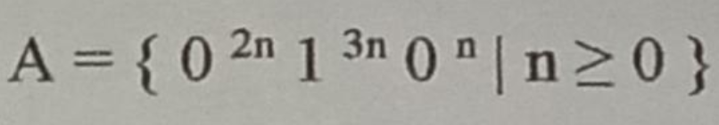
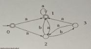
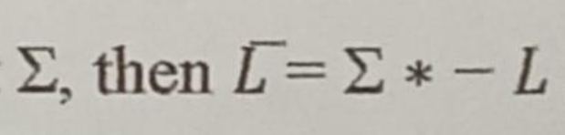
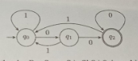

# University of Barishal
### Department of Computer Science and Engineering
**Final Exam | Semester: 6th**

- **Course:** Course Title: Theory of Computation (CSE-3203)
- **Session:** 19-20
- **Time:** 180 minutes | **Full Marks:** 60.00
- **Course Teacher:** Dr. Md Manjur Ahmed

---
> *(Note: Answer any five set of questions from the followings)*

---

### 1. 

**a)** Define Turing Machine. Explain pushdown automaton.

**b)** Prove that every language accepted by a multitap TM is recursively enumerable.

**c)** What do you know about context-free grammars?

---

---

### 2. 

**a)** Define with examples: Alphabet, String, Language

**b)** Give a regular expression for the following language B over the alphabet {a, b}. B={w | w does not contain the substring aaa}.

**c)** When is an expression called regular expression?

---

---

### 3. 

**a)** Use the pumping lemma to prove that the language A is not context-free.

**b)** Convert the following NFA to DFA.

**c)** State the Pumping Lemma for regular languages.

---

---

### 4. 

**a)** Summarize the principal closure properties for regular languages.

**b)** Convert DFA's to regular expressions by eliminating states (using an arbitrary example).

**c)** Prove that if L is a regular language over the following alphabet, then it is also a regular language.

---

---

### 5. 

**a)** Construct a context-free grammar for the following DFA:

**b)** Show that the grammar ({S}, {a, b), R, S) with rules R = S-->aS | aSbS | € is ambiguous.

**c)** Explain inverse homomorphism.

---

---

### 6. 

**a)** Elaborate the three operations on languages that the operations of regular expression represent.

**b)** Prove that if we add a finite set of strings to a regular language, the result is a regular language.

**c)** Write the closure properties of regular languages.

---

---

### 7. 

**a)** Prove that the following are not regular languages: (i) The set of strings of 0's and 1's beginning with 1, such that when interpreted as an integer, that integer is a prime. (ii) The set of strings of the form 0 i1 j such that the greatest common divisor of i and j is 1.

**b)** State the properties of a parse tree. Construct a parse tree for the following string: S --> S S + | S S * l a

**c)** Prove that every language defined by a regular expression is also defined by a finite automata.

---

---

### 8. 

**a)** State formal definition of a finite automata. Give an example.

**b)** Consider the regular expression (a(cd)*b)* (i) Find a string over {a, b, c, d}^4 which matches the expression. (ii) Find a string over {a, b, c, d}4 which does not match the expression.

**c)** Build an e-NFA for the following language: [The question is incomplete]

---

---

---

---

- 

- 

---

---

---

---

