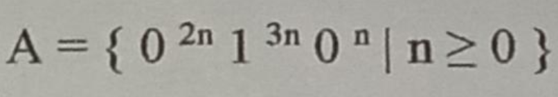

# University of Barishal
### Department of Computer Science and Engineering
**2nd Mid Exam | Semester: 6th**

- **Course:** Course Title: Theory of Computation (CSE-3203)
- **Session:** 19-20
- **Time:** 45 minutes | **Full Marks:** 50.00
- **Course Teacher:** Dr. Md Manjur Ahmed

---
---

### 1. 

**1)** Define push down automata with example.

**2)** Give pushdown automata that recognize the following languages: (a) A = { w∈ {0, 1} * | w contains at least three 1s } (b) B = { w∈ {0, 1} * | w = w^R and the length of w is odd }

**3)** Use the pumping lemma to prove that the language A is not context free.

**4)** Prove that if we add a finite set of strings to a regular language, the result is a regular language.

**5)** Write the closure properties of regular languages.

**6)** Does a push down automata have memory? Justify.

---

---

---

---

- 

- 

---

---

---

---

