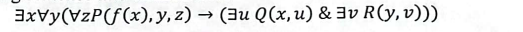
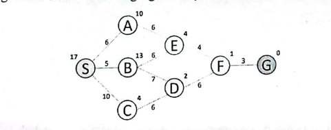
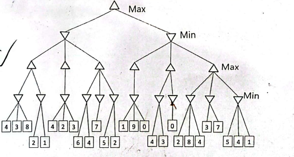
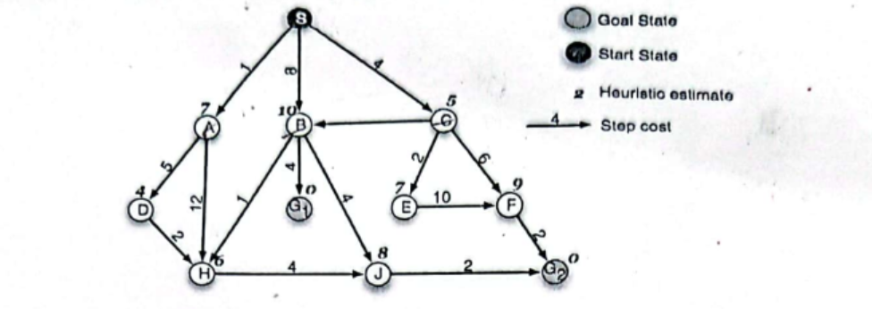
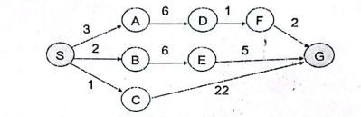
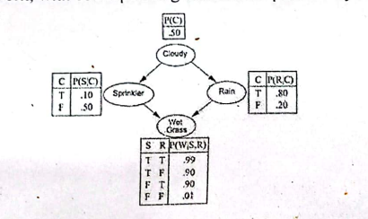

# University of Barishal
### Department of Computer Science and Engineering
**Final Exam | Semester: 6th**

- **Course:** Course Title: Artificial Intelligence (CSE-3205)
- **Session:** 18-19
- **Time:** 180 minutes | **Full Marks:** 60.00
- **Course Teacher:** 

---
> *Answer any five Questions from the followings.*

---

### 1. 

**a)** What is AI? Differentiate between the strong Al and Weak AI.

**b)** Identify the four sources that demonstrate Evidence of Human Intelligence.

**c)** Distinguish between the following properties of a task environment: i. Static or dynamic ii. Discrete or continuous iii.Single or multi-agent

**d)** Briefly explain the PEAS description of the task environment for an automated taxi.

---

---

### 2. 

**a)** Describe the function of vacuum cleaner as an Agent with suitable diagram.

**b)** Convert the following &nbsp; sentence into clausal form:

**c)** For the following database facts, write a completion formula that states that Johny is the only person that lives in Barishal. LIVESIN (johny, Barishal) LIVESIN(alice, Pabna) LIVESIN(darth, bogura) OWNS(johny, smartphone) STUDENT(darth)

---

---

### 3. 

**a)** Define the following terms in your own words: state, state space, search tree, search node, goal, action, transition model, and branching factor.

**b)** Perform A* Algorithm on the following figure. Explicitly write down the queue at each step

---

---

### 4. 

**a)** Give the values calculated by minimax for all states in the tree. Do not use alpha-beta pruning.

**b)** Indicate which branches of the tree will be pruned by alpha-beta pruning?

---

---

### 5. 

**a)** Consider the search space below, where S is the start node and G1 and G2 are goal nodes. Arcs are labeled with the value of a cost function; the number gives the cost of traversing the arc. Above each node is the value of a heuristic function; the number gives the estimate of the distance to the goal. Assume that the algorithms do not keep track of and recognize repeated states. &nbsp; For each of the following search strategies, BFS, DFS, GBFS i. indicate which goal state is reached first (if any) and ii. List in order, all the states that are popped off the OPEN list.

---

---

### 6. 

**a)** The graph above shows the step costs for different paths going from the start (S) to the goal (G).Use uniform cost search to find the optimal path to the goal.

**b)** Write down the advantage of IDS over BFS and DFS. Also, shows times and space complexity among them.

---

---

### 7. 

**a)** What is probabilistic reasoning? How is probabilistic reasoning different from logical reasoning?

**b)** A simple Bayesian Network, with corresponding conditional probability tables, is given below: From the Bayesian network, answer the following questions: i) What is the probability that it is cloudy, it is raining, the sparkler is off, and the grass is wet? ii) What is the probability that it is not cloudy, it is not raining, the sparkler is on, and the grass is wet?

**c)** Explain backward chaining algorithm with suitable example.

---

---

### 8. 

**a)** Translate each of the following sentences into First Order Logic (FOL): i. Not all cars have carburetors ii. Everyone loves everyone. iii.Every connected and circuit-free graph is a tree iv. All that glitters is not gold v. Not all that glitters is gold vi.There is a barber who shaves all men in the town who do not shave themselves

**b)** Discuss the limitations of first-order logic when it comes to expressing certain types of statements or reasoning.

**c)** A proposition with three variables, A, B, and C. Prove that proposition A&and;&not;A&and;(BVC) is a contradiction.

**d)** Prove (AVB)and[(&not;A)&and;(&not;B)] are equivalent.

---

---

---

---

- 

- 

---

---

---

---

