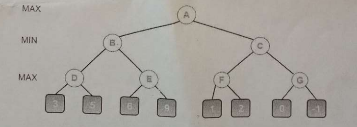
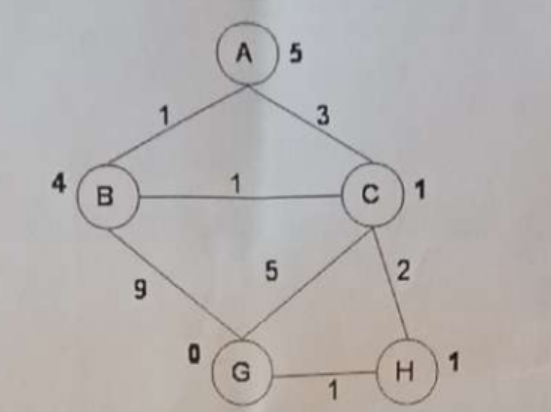
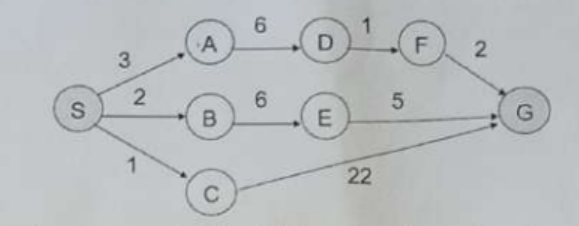
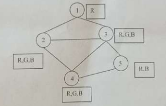

# University of Barishal
### Department of Computer Science and Engineering
**Final Exam | Semester: 6th**

- **Course:** Course Title: Artificial Intelligence (CSE-3205)
- **Session:** 19-20
- **Time:** N/A | **Full Marks:** N/A
- **Course Teacher:** Dr. Tania Islam

---
> *Answer any five questions from the followings*

---

### 1. 

**a)** How is Machine Learning related to Artificial Intelligence?

**b)** Define Agent and Rational Agent through real-time example.

**c)** Distinguish between the following properties of a task environment: i. Static or dynamic ii. Discrete or continuous iii. Single or multi-agent

**d)** What is local maxima? How to escape local maxima?

---

---

### 2. 

**a)** Describe the function of vacuum cleaner as an Agent with suitable diagram.

**b)** Imagine, Mary is a model-based Al that builds and maintains an internal representation of the world. And Greg, on the other hand, is a goal-based Al that focuses on achieving specific objectives. Describe the fundamental differences between Model-Based Mary and Goal-Based Greg in terms of their operational strategies. How does each approach affect their decision-making processes and adaptability to changes in their environment

**c)** Define Rational Agent with example. Is vacuum cleaner agent Rational? Why or why not? Explain with suitable reasons.

---

---

### 3. 

**a)** Define in your own words the following terms: state, state space, search tree, search node, goal, action, transition model, and branching factor.

**b)** What is Greedy Best First Search? Explain with an example the different stages of Greedy Best First search.

**c)** Explain iterative deepening search with example.

---

---

### 4. 

**a)** Explain the process of Minimax without alpha-beta pruning and how it determines the optimal move.

**b)** How does alpha-beta pruning improve the efficiency of the Minimax algorithm in evaluating game trees like the tree?

**c)** Explain the terms "max node" and "min node" in the Minimax algorithm. How are they used to represent players in a game?

---

---

### 5. 

**a)** Consider the graph shown below where the numbers on the links are link costs and the numbers next to the states are heuristic estimates. Note that the arcs are undirected. Let A be the start state and G be the goal state. Simulate A* search with a strict expanded list on this graph. At each step, show the path to the state of the node that's being expanded, the length of that path, the total estimated cost of the path (actual + heuristic), and the current value of the expanded list (as a list of states).

**b)** Is the heuristic given in Problem 5.a admissible? Explain.

**c)** Is the heuristic given in Problem 5.a consistent? Explain.

---

---

### 6. 

**a)** The graph above shows the step costs for different paths going from the start (S) to the goal (G). Use uniform cost search to find the optimal path to the goal.

**b)** Write down the advantage of IDS over BFS and DFS. Also, shows times and space complexity among them.

---

---

### 7. 

**a)** Consider the following constraint graph for a graph coloring problem (the constraints indicate that connected nodes cannot have the same color). The domains are shown in the boxes next to each variable node. Now answer the following questions: I. What are the variable domains after a full constraint propagation? II. Show the sequence of variable assignments during a pure backtracking search (do not assume that the propagation above has been done), assume that the variables are examined in numerical order and the values are assigned in the order shown next to each node.

**b)** What is forward checking algorithm? Give an example.

---

---

### 8. 

**a)** What is logic, syntax and semantics ? Write down some propositional logic syntax.

**b)** Show that p→(q→r) is logically equivalent to (p∧q)→r

**c)** Translate each of the following sentences into First Order Logic (FOL) i. Not all cars have carburetors. ii. All babies are illogical. iii. Every connected and circuit-free graph is a tree. iv. All that glitters is not gold.

---

---

---

---

- 

- 

---

---

---

---

